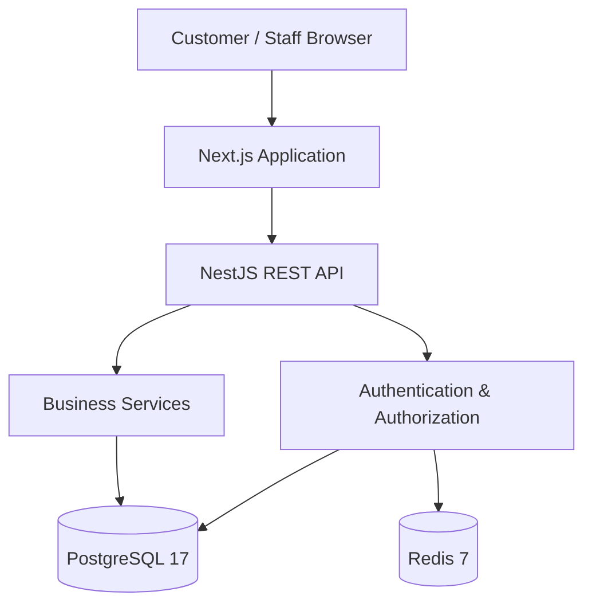

# ⚕️ GULF PHARMACY

### صيدلية الخليج

**Premium Bilingual Pharmacy Platform | Digital Healthcare Experience | Secure Staff Administration**

*Your Health. Our Priority.*

---

**Next.js 16 · React · TypeScript · NestJS · PostgreSQL 17 · Redis 7 · Docker · Tailwind CSS**

**Project Status:** Phase 1 Complete · Phase 2 Complete · Phase 3 Planned

**Location:** Ar Rabi, Dammam, Saudi Arabia  
**Contact:** Dr. Fahad Badshah  
**WhatsApp:** [+966 59 771 3349](https://wa.me/966597713349)  
**Google Maps:** [Find Gulf Pharmacy](https://goo.gl/maps/mhWvzaZhw956to9o8?g_st=aw)

---

## 🌟 Welcome to Gulf Pharmacy

Gulf Pharmacy is a modern, bilingual pharmacy platform designed to connect customers with their local pharmacy while providing secure, scalable tools for staff administration.

The project combines a premium healthcare brand experience with a production-oriented software architecture.

Our vision is to create a platform that delivers:

- ✨ Beautiful, responsive customer experiences
- 🌍 Seamless English and Arabic accessibility
- 💬 Direct WhatsApp customer communication
- 📍 Convenient pharmacy discovery and navigation
- 🔐 Enterprise-grade staff authentication
- 🏢 Secure branch administration
- 📊 Scalable content management and operational tools
- 🚀 High-performance web engineering

The platform begins with the confirmed Gulf Pharmacy branch in Ar Rabi, Dammam.

**Our mission:** Make pharmacy information, communication, and access simpler, faster, and more convenient.

---

# 🎨 01 — Premium Brand Experience

## Visual Identity

The Gulf Pharmacy interface follows a modern healthcare design language featuring emerald green, deep teal, soft mint, elegant typography, and carefully designed motion.

| Design Token | Color | Purpose |
|---|---|---|
| Deep Teal | `#063E3B` | Primary brand backgrounds |
| Emerald Green | `#08796D` | Buttons and interactive elements |
| Soft Mint | `#DFF5EC` | Cards, highlights, and accents |
| Pearl White | `#F7FAF8` | Main page background |
| Pure White | `#FFFFFF` | Surfaces and typography |
| Dark Text | `#123D39` | Headings and content |

### Design Philosophy

**Premium. Minimal. Human-centered. Accessible.**

Every interface should combine visual sophistication with functional clarity.

The design system emphasizes generous whitespace, strong visual hierarchy, premium healthcare imagery, elegant gradients, smooth transitions, and responsive layouts.

### Future Visual Features

- Cinematic homepage hero
- Premium pharmacy photography
- Animated brand storytelling
- Glassmorphism accents
- Smooth scroll interactions
- Interactive category cards
- High-quality campaign banners
- Animated customer chat widget
- Elegant page transitions
- Responsive navigation
- Dark teal visual sections
- Arabic right-to-left layouts
- Accessibility-aware motion

Animations must remain performant and respect reduced-motion preferences.

---

# 🖥️ 02 — Premium Customer Website

**Status: Phase 3 Planned**

The public website will provide a visually engaging experience designed to encourage customer enquiries and pharmacy visits.

## Homepage

The homepage will feature a premium hero section with strong typography, photography, and prominent contact actions.

**Primary headline:**

> Your Health Deserves Better Care.

**Arabic headline:**

> صحتك تستحق رعاية أفضل

**Primary actions:**

- Chat on WhatsApp
- Get Directions
- Explore Pharmacy Information

### Homepage Sections

| Section | Description |
|---|---|
| Hero | Premium brand introduction |
| About | Gulf Pharmacy information and story |
| Categories | Visual product-category discovery |
| Campaigns | Verified, approved promotional content |
| Gallery | Authentic pharmacy photography |
| Health Information | Reviewed educational content |
| Customer Support | Guided bilingual assistance |
| FAQ | Frequently asked questions |
| Contact | WhatsApp, telephone, and Google Maps |
| Footer | Business details and navigation |

Product categories are discovery concepts until the actual inventory is confirmed.

No unverified stock, prices, promotions, opening hours, customer reviews, or additional live branches will be displayed.

---

# 💬 03 — Intelligent Customer Assistance

**Status: Planned**

A floating customer-support assistant will help visitors quickly access pharmacy information.

### Customer Assistance Capabilities

**Bilingual Communication**

Support English and Arabic interactions.

**Pharmacy Information**

Answer verified questions about location, contact details, and published operating hours.

**Product Enquiries**

Allow customers to enquire about products without falsely claiming live inventory availability.

**WhatsApp Handoff**

Transfer enquiries to the pharmacy's official WhatsApp contact.

**Guided FAQ**

Provide structured answers to common customer questions.

### Example Conversation

**Customer:** Hello, do you have this product?

**Assistant:** Welcome to Gulf Pharmacy! Our team can confirm current availability and pricing. Would you like to contact us on WhatsApp?

**Customer:** Yes.

**Assistant:** You can send your enquiry directly to our pharmacy team.

**WhatsApp:** https://wa.me/966597713349

### Safety Requirements

The assistant must not diagnose illnesses, prescribe medication, invent prices, or claim products are available without verified inventory data.

It must clearly identify itself as automated assistance.

Future AI-powered functionality will require additional privacy, clinical-safety, and quality controls.

---

# 🏗️ 04 — System Architecture

The platform uses a modular monorepo architecture designed for maintainability, security, and future expansion.

### Architecture Overview



### Technology Stack

| Layer | Technology |
|---|---|
| Runtime | Node.js 24 LTS |
| Package Manager | pnpm Workspaces |
| Frontend | Next.js App Router |
| UI Library | React |
| Language | Strict TypeScript |
| Styling | Tailwind CSS |
| Backend | NestJS REST API |
| Database | PostgreSQL 17 |
| ORM / Migrations | Drizzle |
| Cache / Rate Limiting | Redis 7 |
| Infrastructure | Docker Compose |
| Code Quality | ESLint, Prettier |
| Languages | English, Arabic |
| Typography | Locally bundled fonts |
| Testing | Automated API, security, and browser tests |

---

# 🔐 05 — Secure Authentication & Administration

**Status: Phase 2 Implemented**

The staff administration platform provides controlled access to protected operational functionality.

### Authentication Security

- Argon2id password hashing
- Hashed server-managed sessions
- Secure HTTP cookie configuration
- CSRF defenses
- Redis-backed rate limiting
- Session expiration and revocation
- Protected administrative routes
- Transactional audit logging

### Authorization

The platform supports role-based access control and branch membership restrictions.

**Super Admin**

Responsible for authorized system-wide administration and staff-access management.

**Branch Admin**

Manages permitted resources for assigned branches.

**Staff Access**

Controlled through administrative assignment rather than public registration.

### Security Principles

- Least-privilege access
- Server-side authorization
- Branch isolation
- Secure session handling
- Auditable administrative operations
- No public staff registration
- No default administrator credentials

---

# 🏢 06 — Branch Management

**Status: Foundation Implemented**

The platform currently includes one confirmed branch.

### Gulf Pharmacy — Dammam

| Field | Information |
|---|---|
| Name | Gulf Pharmacy |
| Arabic | صيدلية الخليج |
| Street | Street 8 |
| District | Ar Rabi |
| City | Dammam |
| Postal Code | 32241 |
| Country | Saudi Arabia |
| Contact | Dr. Fahad Badshah |
| Phone | +966 59 771 3349 |

**Location:** [Open Google Maps](https://goo.gl/maps/mhWvzaZhw956to9o8?g_st=aw)

The database architecture supports future branch management, but additional branches must not be displayed publicly until confirmed.

Repeated database seeding preserves administrator changes to existing records.

---

# 🗄️ 07 — Database Architecture

The project uses PostgreSQL 17 with version-controlled Drizzle migrations.

### Core Phase 2 Tables

| Table | Responsibility |
|---|---|
| `staff_users` | Staff identity and authentication |
| `branch_memberships` | Staff-to-branch access |
| `auth_sessions` | Secure session management |
| `admin_audit_logs` | Administrative audit history |

The original foundation migration and Dammam branch record are preserved.

### Migration Principles

1. Use additive, version-controlled migrations.
2. Never silently destroy existing records.
3. Preserve historical migrations.
4. Maintain referential integrity.
5. Apply schema changes through reviewed migration files.
6. Keep database configuration environment-specific.

**Existing local PostgreSQL port:** `55432`

**Fresh-checkout template recommendation:** `5433`

Do not overwrite an existing environment configuration.

---

# 📁 08 — Repository Structure

The project follows a pnpm monorepo layout.

```text
gulf-pharmacy/
│
├── apps/
│   ├── web/
│   │   ├── app/
│   │   │   └── admin/
│   │   └── features/
│   │       └── admin/
│   │
│   └── api/
│       ├── src/
│       │   ├── auth/
│       │   ├── admin/
│       │   └── cli/
│       │       └── bootstrap.ts
│       └── test/
│
├── packages/
│   └── database/
│       ├── src/
│       │   └── schema.ts
│       └── drizzle/
│           └── 0001_staff_authentication.sql
│
├── infra/
│
├── tests/
│   └── browser/
│
├── docs/
│   ├── SETUP.md
│   ├── ARCHITECTURE.md
│   ├── AUTHENTICATION.md
│   ├── FOLDER_STRUCTURE.md
│   ├── DEPENDENCIES.md
│   ├── TESTING.md
│   ├── DEVELOPMENT_PHASES.md
│   ├── VALIDATION.md
│   └── PHASE_2_VALIDATION.md
│
└── README.md
```

This is a simplified architectural tree. Consult `docs/FOLDER_STRUCTURE.md` for the complete existing repository structure.

---

# ⚙️ 09 — Local Development Setup

## Prerequisites

Install the following:

- Node.js 24 LTS
- pnpm
- Docker Desktop
- Git
- PowerShell
- Visual Studio Code or another compatible editor

## Step 1 — Install Dependencies

```powershell
pnpm install
```

## Step 2 — Configure Environment Files

For the first setup only:

```powershell
Copy-Item infra/.env.example infra/.env
Copy-Item apps/api/.env.example apps/api/.env
Copy-Item apps/web/.env.example apps/web/.env
Copy-Item packages/database/.env.example packages/database/.env
```

Review environment values before continuing.

**Important:** Do not overwrite existing `.env` files containing local customizations or secrets.

## Step 3 — Start Infrastructure

Ensure Docker Desktop is running.

```powershell
pnpm db:up
```

## Step 4 — Apply Migrations

```powershell
pnpm db:migrate
```

## Step 5 — Seed Confirmed Data

```powershell
pnpm db:seed
```

## Step 6 — Start Development

```powershell
pnpm dev
```

### Local URLs

| Service | URL |
|---|---|
| Frontend | http://localhost:3000 |
| API | http://localhost:4000/api |
| Liveness | http://localhost:4000/api/health |
| Dependency Readiness | http://localhost:4000/api/health/dependencies |
| Branches API | http://localhost:4000/api/branches |
| Staff Login | http://localhost:3000/admin/login |

---

# 👤 10 — Super Admin Bootstrap

After applying migrations, create the initial Super Admin.

```powershell
pnpm auth:bootstrap
```

The interactive command securely requests the initial administrator credentials.

Passwords are entered through hidden terminal input.

The bootstrap operation is designed not to create another initial Super Admin when one already exists.

There are no default credentials.

See `docs/AUTHENTICATION.md` for the complete authentication and permissions model.

---

# 🧪 11 — Testing & Validation

Quality assurance is an essential part of the project.

### Automated Testing

```powershell
pnpm test
```

Runs foundation tests and security tests using disposable PostgreSQL and Redis databases.

### TypeScript Validation

```powershell
pnpm typecheck
```

### ESLint

```powershell
pnpm lint
```

### Production Build

```powershell
pnpm build
```

### Browser Testing

```powershell
pnpm test:browser
```

Runs real Chrome workflows for public and administrative interfaces at desktop, tablet, and mobile sizes.

The frontend must be running before executing the browser suite.

### Formatting Validation

```powershell
pnpm format:check
```

### Quality Targets for Phase 3

| Category | Target |
|---|---|
| Lighthouse Performance | 90+ |
| Accessibility | WCAG 2.2 AA |
| SEO | 90+ Lighthouse target |
| Responsive Design | Mobile, tablet, desktop |
| Motion | Reduced-motion support |
| Type Safety | Strict TypeScript |
| Security | No regression of Phase 2 controls |
| Browser Testing | Critical workflows verified |

These are future acceptance targets, not measured results.

---

# 🚀 12 — Development Roadmap

## Phase 1 — Platform Foundation

**Status: Completed**

Established the monorepo architecture, frontend, backend, database integration, branch foundation, and development infrastructure.

## Phase 2 — Staff Authentication & Administration

**Status: Completed and Locally Verified**

Implemented secure staff authentication, administrative access, branch membership controls, audit logging, and regression tests.

## Phase 3 — Premium Digital Experience

**Status: Planned — Not Yet Implemented**

### Phase 3A — Premium Frontend

- Advanced design system
- Animated homepage
- Responsive navigation
- Premium typography
- Brand imagery
- Motion design
- Accessible components

### Phase 3B — Public Website

- About page
- Product-category discovery
- Pharmacy gallery
- Contact and directions
- English/Arabic localization
- SEO foundation

### Phase 3C — Customer Engagement

- Floating chat assistant
- WhatsApp handoff
- Guided FAQs
- Enquiry workflows
- Privacy-conscious conversion tracking

### Phase 3D — Content Administration

- Banner management
- Gallery management
- Approved promotional content
- FAQ management
- Branch information updates
- Audited administrative actions

### Phase 3E — Production Readiness

- Browser regression testing
- Security validation
- Performance optimization
- Accessibility auditing
- SEO validation
- Deployment configuration

---

# 📊 13 — Available Development Commands

| Command | Description |
|---|---|
| `pnpm dev` | Start both applications |
| `pnpm dev:web` | Start frontend |
| `pnpm dev:api` | Start backend |
| `pnpm build` | Build packages and applications |
| `pnpm lint` | Run ESLint |
| `pnpm typecheck` | Run TypeScript validation |
| `pnpm test` | Run automated tests |
| `pnpm test:browser` | Run browser workflows |
| `pnpm auth:bootstrap` | Create initial Super Admin |
| `pnpm format` | Format source code |
| `pnpm format:check` | Validate formatting |
| `pnpm db:up` | Start infrastructure |
| `pnpm db:down` | Stop infrastructure |
| `pnpm db:generate` | Generate migrations |
| `pnpm db:migrate` | Apply migrations |
| `pnpm db:seed` | Seed confirmed branch data |

---

# 🌐 14 — SEO & Digital Growth

The premium public website will be optimized for discoverability and customer engagement.

### Planned SEO Features

- Semantic HTML
- Structured metadata
- Open Graph previews
- XML sitemap
- Canonical URLs
- Optimized image loading
- Local business structured data
- English and Arabic page metadata
- Search-friendly routing
- Core Web Vitals optimization

### Customer Engagement Strategy

The website should encourage meaningful actions rather than relying on intrusive advertising.

Primary conversion goals:

1. WhatsApp enquiries
2. Google Maps direction requests
3. Phone contact
4. Product-category enquiries
5. Engagement with approved informational content

Any analytics must respect applicable privacy and consent requirements.

---

# 🛡️ 15 — Privacy, Security & Compliance

Gulf Pharmacy handles customer-facing healthcare information and staff administration functionality.

Security and trust must remain central to the platform.

### Security Requirements

- Secure session management
- Role-based authorization
- Server-side permission enforcement
- Branch data isolation
- Rate limiting
- CSRF protection
- Audit logging
- Secure environment configuration
- Dependency monitoring
- Safe error handling

### Customer Privacy

Avoid unnecessary collection of medical or personally identifiable information.

Do not request prescriptions or sensitive health records through an unsecured general-purpose chat.

### Advertising Integrity

Only publish verified business information and approved promotional claims.

No fabricated testimonials, certifications, medicine availability, discounts, or operating hours.

Medicine and healthcare advertising must be reviewed against applicable Saudi regulatory requirements before publication.

---

# 📚 16 — Project Documentation

Detailed technical documentation is maintained in the `docs/` directory.

| Document | Description |
|---|---|
| `SETUP.md` | Windows setup and troubleshooting |
| `ARCHITECTURE.md` | System architecture |
| `AUTHENTICATION.md` | Authentication and authorization |
| `FOLDER_STRUCTURE.md` | Complete repository guide |
| `DEPENDENCIES.md` | Installed dependencies |
| `TESTING.md` | Testing procedures |
| `DEVELOPMENT_PHASES.md` | Development roadmap |
| `VALIDATION.md` | Phase 1 validation |
| `PHASE_2_VALIDATION.md` | Phase 2 verification |

---

# 💚 17 — Our Commitment

**Gulf Pharmacy is more than a website.**

It is a long-term digital foundation for a modern neighborhood pharmacy, combining a distinctive brand experience with secure engineering and customer-friendly communication.

The goal is to create a platform that is:

**Beautiful to explore. Easy to use. Secure to operate. Built to evolve.**

---

### ⚕️ GULF PHARMACY | صيدلية الخليج

**Your Health. Our Priority.**

📍 Street 8, Ar Rabi, Dammam 32241, Saudi Arabia

📱 WhatsApp: [+966 59 771 3349](https://wa.me/966597713349)

🗺️ [Get Directions](https://goo.gl/maps/mhWvzaZhw956to9o8?g_st=aw)

**Built with modern web technologies. Designed for a better pharmacy experience.**

© 2026 Gulf Pharmacy. All rights reserved.
