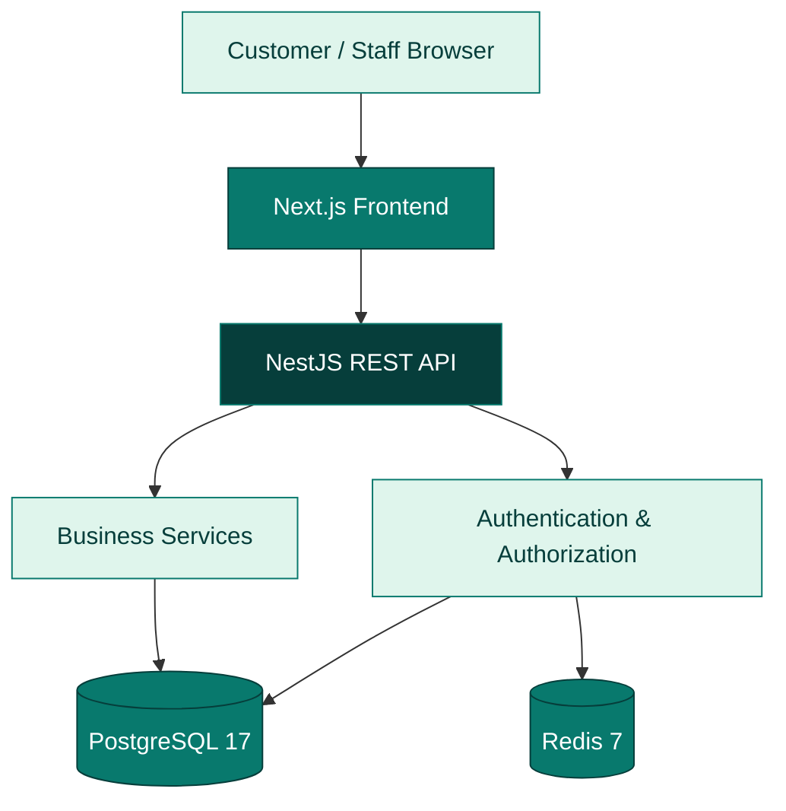

 <div align="center">


# ⚕ GULF PHARMACY
### صيدلية الخليج

**PREMIUM DIGITAL HEALTHCARE PLATFORM**

*Engineering a Smarter Pharmacy Experience.*


**Phase 1: Complete** · **Phase 2: Complete** · **Phase 3: Planned**

</div>

---

## ✨ Overview

**Gulf Pharmacy** is a modern bilingual digital pharmacy platform built with enterprise-oriented engineering practices.

The project combines a secure administrative foundation with a roadmap for premium customer-facing experiences, advanced visual design, and scalable content management.

### Core Principles

- 🎨 Premium healthcare user experience
- 🌐 Bilingual English and Arabic interface
- 🔐 Secure authentication and authorization
- 🏢 Branch-aware administration
- ⚡ High-performance architecture
- 📱 Mobile-first responsive design
- 🧩 Modular and maintainable codebase
- 🚀 Production-oriented development

---

## 🎨 Design System

The platform follows a sophisticated emerald-green visual identity.

| Color | Hex | Usage |
|---|---|---|
| 🟩 Deep Teal | `#063E3B` | Primary brand |
| 🟢 Emerald Green | `#08796D` | Interactive components |
| 🌿 Soft Mint | `#DFF5EC` | Cards and accents |
| ⚪ Pearl White | `#F7FAF8` | Background |
| ⚫ Dark Teal | `#123D39` | Text |

### Planned Visual Experience

- Cinematic hero sections
- Premium healthcare photography
- Smooth scroll animations
- Animated navigation
- Interactive category cards
- Glassmorphism details
- Responsive image galleries
- Micro-interactions
- Elegant loading states
- Reduced-motion accessibility
- Full Arabic RTL support

---

## 🏗 System Architecture



---

## 🛠 Technology Stack

| Layer | Technology |
|---|---|
| Runtime | Node.js 24 LTS |
| Package Manager | pnpm Workspaces |
| Frontend | Next.js App Router, React |
| Language | Strict TypeScript |
| Styling | Tailwind CSS |
| Backend | NestJS REST API |
| Database | PostgreSQL 17 |
| ORM | Drizzle |
| Cache | Redis 7 |
| Infrastructure | Docker Compose |
| Code Quality | ESLint, Prettier |
| Localization | English / Arabic |
| Testing | Unit, integration, security, browser |

---

## 🔐 Authentication & Security

**Phase 2 — Implemented and Locally Verified**

The platform provides secure staff authentication and branch-aware administration.

### Implemented Features

- Argon2id password hashing
- Hashed server-managed sessions
- Secure cookie configuration
- CSRF protection
- Redis rate limiting
- Role-based access control
- Branch membership isolation
- Session revocation
- Transactional audit logging
- Protected administrative routes
- Interactive Super Admin bootstrap

No public staff registration or default credentials are provided.

---

## 📁 Project Structure

```text
gulf-pharmacy/
│
├── apps/
│   ├── web/
│   │   ├── app/
│   │   │   └── admin/
│   │   └── features/
│   │       └── admin/
│   │
│   └── api/
│       ├── src/
│       │   ├── auth/
│       │   ├── admin/
│       │   └── cli/
│       └── test/
│
├── packages/
│   └── database/
│       ├── src/
│       └── drizzle/
│
├── infra/
│
├── tests/
│   └── browser/
│
├── docs/
│   ├── assets/
│   ├── SETUP.md
│   ├── ARCHITECTURE.md
│   ├── AUTHENTICATION.md
│   ├── TESTING.md
│   ├── DEVELOPMENT_PHASES.md
│   └── PHASE_2_VALIDATION.md
│
└── README.md
```

---

## 🚀 Quick Start

### Requirements

- Node.js 24 LTS
- pnpm
- Docker Desktop
- Git
- PowerShell

### Installation

```powershell
pnpm install
```

### Environment Configuration

On first setup:

```powershell
Copy-Item infra/.env.example infra/.env
Copy-Item apps/api/.env.example apps/api/.env
Copy-Item apps/web/.env.example apps/web/.env
Copy-Item packages/database/.env.example packages/database/.env
```

Do not overwrite existing environment files.

### Start Infrastructure

```powershell
pnpm db:up
```

### Database Initialization

```powershell
pnpm db:migrate
pnpm db:seed
```

### Start Development

```powershell
pnpm dev
```

### Create Initial Administrator

```powershell
pnpm auth:bootstrap
```

---

## 🧪 Testing & Quality Assurance

| Command | Purpose |
|---|---|
| `pnpm build` | Production build |
| `pnpm lint` | ESLint validation |
| `pnpm typecheck` | Strict TypeScript checks |
| `pnpm test` | Automated tests |
| `pnpm test:browser` | Browser regression testing |
| `pnpm format:check` | Formatting validation |

### Future Quality Targets

| Category | Goal |
|---|---|
| Performance | Lighthouse 90+ |
| Accessibility | WCAG 2.2 AA |
| SEO | Lighthouse 90+ |
| Responsive | Desktop, tablet, mobile |
| Security | Preserve Phase 2 controls |
| Localization | Complete English and Arabic |
| Animation | Smooth, accessible motion |

These are planned quality targets, not measured production results.

---

## 🗺 Development Roadmap

### ✅ Phase 1 — Foundation

**Completed**

- Monorepo architecture
- Frontend and backend setup
- Database integration
- Infrastructure configuration
- Initial branch foundation
- Development tooling

### ✅ Phase 2 — Secure Administration

**Completed and Locally Verified**

- Staff authentication
- Secure session management
- Role-based authorization
- Branch membership controls
- Administrative audit logging
- Security and browser regression tests

### ⏳ Phase 3 — Premium Digital Experience

**Planned**

#### 3A — Premium UI

- Animated homepage
- Advanced design system
- Responsive navigation
- Brand imagery
- Elegant transitions

#### 3B — Public Website

- About and information pages
- Category discovery
- Image gallery
- Contact interface
- Full bilingual support

#### 3C — Customer Engagement

- Guided customer chat
- FAQ assistant
- Enquiry workflows
- Customer communication handoff

#### 3D — Content Management

- Banner administration
- Gallery management
- Approved campaign content
- FAQ management
- Public content publishing

#### 3E — Production Readiness

- Security regression tests
- Performance optimization
- Accessibility validation
- SEO implementation
- Deployment preparation

---

## 📚 Documentation

| Document | Description |
|---|---|
| `docs/SETUP.md` | Installation and environment setup |
| `docs/ARCHITECTURE.md` | System architecture |
| `docs/AUTHENTICATION.md` | Authentication and permissions |
| `docs/FOLDER_STRUCTURE.md` | Complete source tree |
| `docs/DEPENDENCIES.md` | Installed dependencies |
| `docs/TESTING.md` | Testing procedures |
| `docs/DEVELOPMENT_PHASES.md` | Development roadmap |
| `docs/VALIDATION.md` | Phase 1 validation |
| `docs/PHASE_2_VALIDATION.md` | Phase 2 verification |

---

## 🌟 Engineering Philosophy

> **Beautiful experiences. Secure architecture. Sustainable engineering.**

Gulf Pharmacy is designed around four principles:

**Experience First** — Create intuitive, accessible, and visually refined interfaces.

**Security by Design** — Protect administrative access and enforce authorization at every layer.

**Scalable Architecture** — Build modular systems that support future growth.

**Continuous Improvement** — Validate every development phase through testing and documentation.

---

<div align="center">


### ⚕ GULF PHARMACY
**صيدلية الخليج**

*Engineering a Smarter Pharmacy Experience.*

**Built with Next.js · NestJS · TypeScript · PostgreSQL · Redis**

© 2026 Gulf Pharmacy. All rights reserved.

</div>
