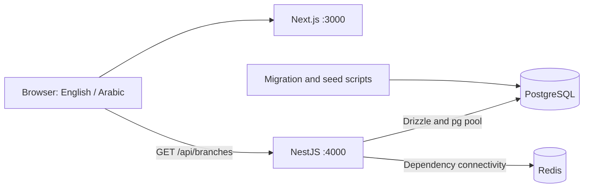

# Architecture

Next.js serves a responsive homepage. Its browser API client loads the confirmed branch from NestJS, with a six-second timeout, loading state, and retryable error state. Language switching updates document language/direction; CSS uses logical properties. Fonts ship with the application, so builds do not fetch Google Fonts. API URLs are public configuration; credentials stay server-side.

NestJS uses feature modules, dependency injection, request DTO validation, a global `/api` prefix, and an allowlisted development CORS origin. BranchesRepository owns queries. BranchesService projects a public response without persistence metadata. Only active branches are returned; unknown slugs return 404 and invalid slugs return 400. Unexpected request errors return a generic 503 without query or connection secrets.

GET `/api/health` is process liveness. GET `/api/health/dependencies` independently probes PostgreSQL and Redis, returns `up`/`down`, and uses HTTP 503 if either is unavailable. Redis reconnects after temporary outages. Connection/query timeouts bound readiness checks. Shutdown hooks close the pool and Redis client.

PostgreSQL holds branch records. UUID primary keys, unique slugs, required fields, slug/country/HTTPS checks, and timezone-aware timestamps constrain the first schema. Drizzle updates `updated_at` on ORM updates; direct SQL writers must set it explicitly. Checked-in SQL and Drizzle metadata define migrations; generation never replaces migration application. The seed inserts the confirmed Dammam branch only if its slug is missing; repeated runs preserve subsequent administrator edits.

Redis now also enforces atomic login/password-change attempt limits. There are no cache policies, queues, workers, or AI services. Docker hosts infrastructure only, bound to IPv4 loopback; Next.js and NestJS run on Windows. Persistent volumes survive `db:down`.

Shared contains only framework-independent branch contracts and a branch slug constant. Database exports server-only schema and a connection factory. Workspace dependencies enforce build order. After editing shared or database source during development, rerun that package's build and restart the app as needed.

Local Compose configuration is for development. A production deployment still requires secret management, TLS, backups, monitoring, and reviewed account recovery procedures.

## Phase 2 administration

The existing frontend serves `/admin/login`, `/admin/dashboard`, `/admin/branches`, `/admin/branches/[id]`, `/admin/staff`, and `/admin/settings`. Shared layout, form, loading, error, and confirmation components support English/Arabic and responsive layouts. Dashboard counts come from actual authorized API data. The browser includes HttpOnly cookies using credentialed fetch; tokens never enter localStorage, page URLs, or API JSON. The visual session boundary redirects anonymous users, while NestJS guards and transactional service checks enforce the actual security boundary.

AuthModule owns password verification, rate-limit calls, session issuance/validation/revocation, cookie handling, profile retrieval, and self-service password changes. AdminModule owns branch-scoped profile queries, staff creation/disabling, and membership replacement. Global request checks reject unsafe methods without the exact approved Origin, JSON content type, and custom request header. CORS permits credentials for the configured origin. A production origin must be HTTPS.

PostgreSQL adds staff_users, branch_memberships, auth_sessions, and admin_audit_logs through migration 0001; migration 0000 and existing branch records remain intact. Argon2id hashes protect passwords; SHA-256 digests protect random session tokens at rest. Staff and branch permissions are reread on each protected action. Account/membership changes revoke affected sessions, password changes revoke all old sessions, and administrative mutations write audit records inside the same transaction.

See [authentication](AUTHENTICATION.md) for the lifecycle Mermaid diagram, role matrix, cookie/CSRF rules, endpoints, and bootstrap process. See [testing](TESTING.md) for disposable database isolation and real-browser verification.
