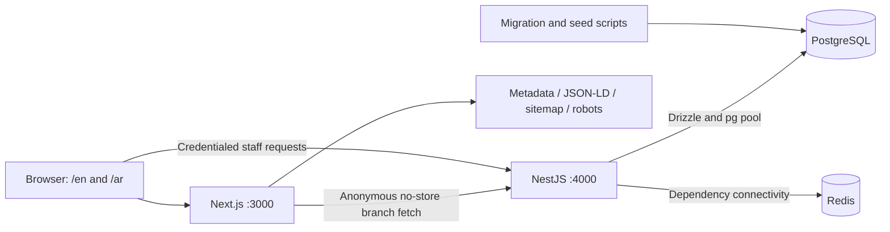

# Architecture

Next.js serves localized home, directory/profile, about, contact, privacy, and website-information routes. Server components fetch published branch data with cache=no-store and a five-second timeout. Dictionaries render translations and metadata on the server. Proxy derives document locale from the URL for SSR; a small client component synchronizes lang/dir when Next retains the root layout during navigation. CSS uses logical properties and locally bundled fonts. Public failures render translated retry states. Staff requests continue using the existing browser API client and protected cookies; database credentials remain server-only.

NestJS uses feature modules, dependency injection, DTO validation, `/api`, and allowlisted CORS. BranchesRepository owns queries. BranchesService projects public business data without staff, session, membership, or audit information. Public queries require active and published state. Unknown/unpublished slugs return 404; invalid API parameters return 400. Unexpected errors return a generic 503 without connection/query secrets. API responses use X-Robots-Tag to exclude indexing.

GET `/api/health` is process liveness. GET `/api/health/dependencies` independently probes PostgreSQL and Redis, returns `up`/`down`, and uses HTTP 503 if either is unavailable. Redis reconnects after temporary outages. Connection/query timeouts bound readiness checks. Shutdown hooks close the pool and Redis client.

PostgreSQL holds branch records. UUID primary keys, unique slugs, required fields, slug/country/HTTPS checks, and timezone-aware timestamps constrain the first schema. Drizzle updates `updated_at` on ORM updates; direct SQL writers must set it explicitly. Checked-in SQL and Drizzle metadata define migrations; generation never replaces migration application. The seed inserts the confirmed Dammam branch only if its slug is missing; repeated runs preserve subsequent administrator edits.

Redis now also enforces atomic login/password-change attempt limits. There are no cache policies, queues, workers, or AI services. Docker hosts infrastructure only, bound to IPv4 loopback; Next.js and NestJS run on Windows. Persistent volumes survive `db:down`.

Shared contains only framework-independent branch contracts and a branch slug constant. Database exports server-only schema and a connection factory. Workspace dependencies enforce build order. After editing shared or database source during development, rerun that package's build and restart the app as needed.

Local Compose configuration is for development. A production deployment still requires secret management, TLS, backups, monitoring, and reviewed account recovery procedures.

## Phase 2 administration

The existing frontend serves `/admin/login`, `/admin/dashboard`, `/admin/branches`, `/admin/branches/[id]`, `/admin/staff`, and `/admin/settings`. Shared layout, form, loading, error, and confirmation components support English/Arabic and responsive layouts. Dashboard counts come from actual authorized API data. The browser includes HttpOnly cookies using credentialed fetch; tokens never enter localStorage, page URLs, or API JSON. The visual session boundary redirects anonymous users, while NestJS guards and transactional service checks enforce the actual security boundary.

AuthModule owns password verification, rate-limit calls, session issuance/validation/revocation, cookie handling, profile retrieval, and self-service password changes. AdminModule owns branch-scoped profile queries, staff creation/disabling, and membership replacement. Global request checks reject unsafe methods without the exact approved Origin, JSON content type, and custom request header. CORS permits credentials for the configured origin. A production origin must be HTTPS.

PostgreSQL adds staff_users, branch_memberships, auth_sessions, and admin_audit_logs through migration 0001; migration 0000 and existing branch records remain intact. Argon2id hashes protect passwords; SHA-256 digests protect random session tokens at rest. Staff and branch permissions are reread on each protected action. Account/membership changes revoke affected sessions, password changes revoke all old sessions, and administrative mutations write audit records inside the same transaction.

See [authentication](AUTHENTICATION.md) for the lifecycle Mermaid diagram, role matrix, cookie/CSRF rules, endpoints, and bootstrap process. See [testing](TESTING.md) for disposable database isolation and real-browser verification.

## Phase 3 public content and SEO

Migration 0002 adds publication, bilingual descriptions/public contacts, optional postal code, structured hours/services, and public_updated_at. New records default to draft; only the existing verified Dammam branch is published by migration. Existing rows/migrations and administrator edits are retained.

The branch editor adds these fields without changing sessions or staff management. Assigned Branch Admins edit permitted text/contact fields; Super Admin controls publication and approved hours/services. Changes and field-name audit records share a transaction. Subsequent public requests reflect current approved database values.

Metadata, canonical/hreflang links, Pharmacy JSON-LD, sharing metadata, sitemap, and robots use optional validated SITE_ORIGIN. No production domain is assumed; unconfigured local builds are noindex. Branch fetches/sitemap reads are dynamic and no-store. Decorative branding uses CSS/vectors rather than fictional storefront photographs. Contact data attributes provide a future analytics hook without installing tracking. See [SEO](LOCAL_SEO.md), [branch management](BRANCH_MANAGEMENT.md), and [validation](PHASE_3_VALIDATION.md).

## Phase 4 Academy

[Health Academy](HEALTH_ACADEMY.md) adds private media storage, additive migration 0003, an independent BullMQ/FFmpeg worker, revision-based medical and compliance approvals, controlled range delivery, bilingual public video pages and anonymous aggregate signals. Existing staff sessions, branch memberships and administrative audits remain the authorization foundation. Public media gates are checked on every request. Source uploads are never served. See [workflow](VIDEO_WORKFLOW.md) and [storage](VIDEO_STORAGE.md).
