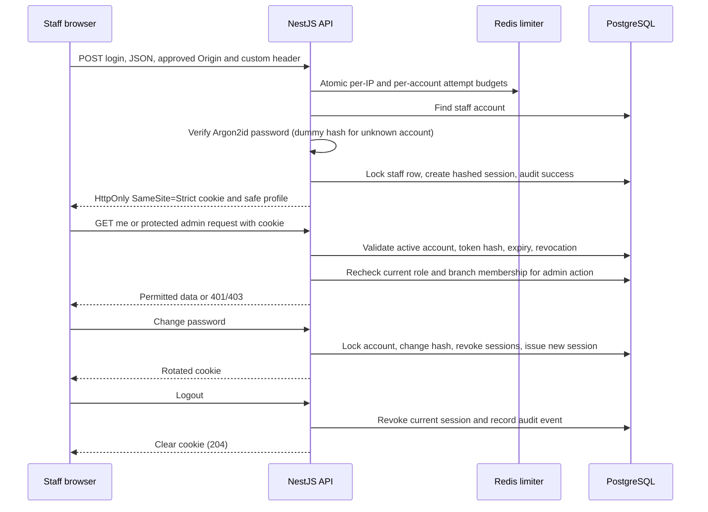

# Staff authentication and branch permissions

Phase 2 uses the existing NestJS API, PostgreSQL, and Redis. There is no public registration or browser token storage. Staff sign in with a lowercase username, not an email address. The public homepage and public branch/health endpoints remain unauthenticated.

## Session lifecycle



Password hashes use Argon2id, 64 MiB memory, three passes, and one lane with a random salt. New passwords must contain 15–128 characters. Passwords and hashes are omitted from all responses and audit records. Unknown usernames and wrong passwords produce the same generic 401 login error; unknown accounts still perform an Argon2 verification.

Sessions use 32 random bytes (256 bits) encoded as base64url. Only a SHA-256 digest is stored in PostgreSQL. A successful login creates a fresh token and revokes a presented old session. Password changes verify the current password, revoke every existing session for that account, and issue a replacement for the current browser. Absolute expiry defaults to eight hours and is configurable between one and 24 hours. Logout revokes the database record and clears the cookie. Disabled accounts and revoked/expired sessions are rejected on subsequent requests. No automatic sliding renewal extends the absolute expiry.

The local cookie is `gulf_session`. Production uses `__Host-gulf_session`, with Secure, HttpOnly, SameSite=Strict, Path=/, and no Domain attribute. Authentication and administration API responses are no-store. The frontend keeps only the returned safe profile in React memory. It revalidates on focus, every minute, at absolute expiry, and on API 401 responses; expired sessions return to sign-in.

Every state-changing request must use JSON, an exact allowed `Origin`, and `X-Gulf-Request: admin`. Missing/foreign Origin and simple form submissions are rejected, including login CSRF. CORS allows credentials only for the configured origin and approved methods/headers. SameSite is additional protection. The server does not trust client-supplied forwarding headers for login IP limits. Reverse-proxy deployments need an explicitly reviewed trust configuration.

Redis atomically limits each source IP to 30 attempts and each normalized account identity to five attempts per 15-minute fixed window. Password-change attempts use the same IP budget and a separate account key. Successful attempts also consume budget. Identifiers are SHA-256 digests in limiter keys; no raw usernames or IPs are stored there. Redis failure rejects authentication requests with a safe service error instead of silently disabling limits. Test instances use separate expiring key namespaces.

These choices follow the official [OWASP session management guidance](https://cheatsheetseries.owasp.org/cheatsheets/Session_Management_Cheat_Sheet.html) and [password storage guidance](https://cheatsheetseries.owasp.org/cheatsheets/Password_Storage_Cheat_Sheet.html).

## Role matrix

| Capability                                                   | SUPER_ADMIN  | BRANCH_ADMIN              | PHARMACIST / MEDICAL_REVIEWER |
| ------------------------------------------------------------ | ------------ | ------------------------- | ----------------------------- |
| Public website and public endpoints                          | Yes          | Yes                       | Public access                 |
| Staff sign-in, own profile/password/logout                   | Yes          | Yes                       | Reserved; sign-in disabled    |
| List/read protected branch profiles                          | All branches | Explicit memberships only | No                            |
| Edit permitted business profile fields                       | All branches | Explicit memberships only | No                            |
| List staff                                                   | Yes          | No                        | No                            |
| Create Branch Admin                                          | Yes          | No                        | No                            |
| Enable/disable Branch Admin                                  | Yes          | No                        | No                            |
| Replace branch memberships                                   | Yes          | No                        | No                            |
| Modify/disable a Super Admin through staff API               | No           | No                        | No                            |
| Grant reserved roles or create more Super Admins through API | No           | No                        | No                            |

Super Admin bootstrap is a CLI-only operation. Protecting Super Admin accounts from modification through the staff API prevents accidental lockout. Self-service password changes still work. Additional Super Admin provisioning or recovery requires a separately reviewed operational procedure; there is no unauthenticated recovery endpoint in this phase.

Both guards and services enforce authorization. Services lock and reread the acting account, check its current session, and query PostgreSQL memberships inside the transaction. Membership changes lock the target staff row and revoke all its sessions. A Branch Admin changing an API branch UUID receives 403 for an unassigned branch. Super Admin requests for nonexistent branches receive 404. UUID validation rejects malformed identifiers before queries.

Branch editing permits English/Arabic names and addresses, city, district, phone, WhatsApp/Google Maps links, and (in Phase 3) bilingual public descriptions/contact names and postal code. Super Admin alone can change publication, verified hours, and approved services. Identity, slug, country, activation, and permissions cannot be changed through this profile endpoint. URLs require HTTPS and the intended hosts. Required business text cannot be blank; optional text can be cleared. Control characters are rejected except description line breaks. React escapes displayed text and Drizzle parameterizes queries. See [branch management](BRANCH_MANAGEMENT.md).

Audit logs are written transactionally with successful login/logout/password changes, bootstrap, account creation/updates, branch edits, and membership assignments. Failed login attempts also generate a minimal event. Audit details contain changed field names or membership UUIDs, never password values, hashes, or session tokens. There is no audit editing/deletion endpoint. Production operations should set retention and backup policy before deployment.

## API endpoints

All paths below include `/api`:

| Method | Path                           | Access                                                    |
| ------ | ------------------------------ | --------------------------------------------------------- |
| POST   | `/auth/login`                  | Public, CSRF checks and rate limit                        |
| GET    | `/auth/me`                     | Valid staff session                                       |
| POST   | `/auth/logout`                 | Valid staff session; returns 204                          |
| POST   | `/auth/change-password`        | Valid staff session and current password                  |
| GET    | `/admin/branches`              | All branches for Super Admin; assigned branches otherwise |
| GET    | `/admin/branches/:id`          | Authorized branch                                         |
| PATCH  | `/admin/branches/:id`          | Authorized branch, permitted profile fields only          |
| GET    | `/admin/users`                 | Super Admin                                               |
| POST   | `/admin/users`                 | Super Admin; creates only BRANCH_ADMIN                    |
| PATCH  | `/admin/users/:id`             | Super Admin; displayName/isActive on Branch Admin only    |
| GET    | `/admin/users/:id/memberships` | Super Admin                                               |
| PUT    | `/admin/users/:id/memberships` | Super Admin; replaces assignments and revokes sessions    |

Creating an account requires `username`, `displayName`, `password`, and at least one `branchIds` entry. Membership replacement permits an empty array to remove access. Unknown fields such as `role`, `passwordHash`, or `isActive` on branch profiles are rejected with 400. A duplicate staff username returns 409 to the already authenticated Super Admin. Requests with no valid session return 401; authenticated users lacking permission receive 403.

## Create the first Super Admin

Preserve the existing local environment files (database port **55432**). From an interactive PowerShell terminal:

```powershell
Set-Location C:\Users\pc\gulf-pharmacy-platform
pnpm install
pnpm db:up
pnpm db:migrate
pnpm auth:bootstrap
```

Enter your chosen username, display name, and a unique 15–128-character password twice. Password input is hidden; do not pass it in shell arguments or put it in a committed file. The command builds its dependencies, uses an advisory transaction lock, and creates only the initial Super Admin. Repeating it when any Super Admin already exists makes no changes and never resets a password. There are no default credentials. No real staff accounts were created during implementation.

Start `pnpm dev`, open http://localhost:3000/admin/login, and sign in. Go to **Staff & access**, enter the real Branch Admin's details and a unique initial password, select **Gulf Pharmacy** (the confirmed Dammam branch), and select **Create Branch Admin**. Share credentials through an approved secure channel. The Branch Admin can then sign in, see only assigned branches, and change their password in **My settings**. Use the staff directory to update branch access or disable the account; confirmation dialogs explain session revocation.

## Configuration and deployment

`apps/api/.env` adds optional `NODE_ENV=development` and `SESSION_HOURS=8` defaults; existing local files continue working without replacement. Keep DATABASE_URL on port 55432 here. Templates use 5433 for fresh installations. Browser API URL remains http://localhost:4000 and the approved browser origin remains http://localhost:3000. Use localhost consistently; switching the browser to 127.0.0.1 changes the Origin and cookie host.

For production set NODE_ENV=production and an exact HTTPS CORS_ORIGIN with no trailing slash, use HTTPS for the API, and rebuild Next.js with the correct public API URL. Keep frontend and API on the same schemeful site for SameSite=Strict cookies. Production startup rejects an HTTP frontend origin. Local and production cookies intentionally have different names. Argon2's native build is explicitly allowlisted in pnpm-workspace.yaml. Production TLS/proxy, secret management, backups, and account recovery procedures are operational deployment work; this change does not publish the app.

## Phase 4 role activation

PHARMACIST and MEDICAL_REVIEWER can now authenticate using the same staff sessions and password lifecycle. Academy guards revalidate role, membership, active account/session and per-video reviewer assignment transactionally. Existing branch-business edits remain restricted to Super Admin/Branch Admin. Existing administrators do not receive medical approval access. Super Admin provisions Academy staff through /api/admin/academy/staff; existing Branch Admin creation API remains unchanged. Existing disable/membership controls support all three non-Super roles. See [medical review](MEDICAL_REVIEW.md).
